<div align="center">
  

  <h2>Make any model uncensored.</h2>

  <p>
    <strong>Fuse any model with an uncensored model at runtime.</strong><br>
    Keep the smart model's capabilities. Let the uncensored model write the final answer.
  </p>

  <p>
    <a href="https://github.com/Shannon-Tool/BreakFuser/actions/workflows/ci.yml"></a>
    <a href="https://pypi.org/project/BreakFuser/"></a>
    <a href="LICENSE"></a>
  </p>

  <p>
    <a href="https://shannon-ai.com/">SHANNON</a> ·
    <a href="https://huggingface.co/shannon-ai">Hugging Face</a> ·
    <a href="docs/index.md">Documentation</a> ·
    <a href="CONTRIBUTING.md">Contribute</a>
  </p>
</div>

## Any model. One uncensored endpoint.

BreakFuser makes any model uncensored by fusing it with an uncensored model. Your **smart model** contributes reasoning, facts, code, and domain knowledge. Your chosen **uncensored model** owns the conversation and fuses that knowledge into the final response. The result is designed to retain the smart model's capabilities while reducing overrefusals, unnecessary hedging, and omitted answers.

This is **runtime model fusion**, not weight merging. BreakFuser does not modify the original model or blindly relay its raw response. It detects refusals and incomplete answers, recovers useful knowledge through bounded follow-up turns, and gives that evidence to the uncensored model for one seamless answer.

- **Fuse any two compatible models:** combine hosted APIs, Ollama, vLLM, SGLang, or another OpenAI-compatible server.
- **Preserve capability:** keep the smart model's reasoning, coding, research, and domain expertise in the fusion process.
- **Reduce overrefusals:** decomposition, crescendo, refusal repair, continuation, and expert framing recover refused or incomplete knowledge automatically.
- **One uncensored response:** the uncensored model retains the original context and performs final synthesis instead of exposing a chain of intermediate prompts.
- **Drop-in compatibility:** use the Python client or point existing tools at `/v1/chat/completions`; no custom headers or harness changes are needed.
- **Ready for real workflows:** streaming, function calling, response formats, skills, and MCP use the same fusion pipeline.
- **Auditable by design:** provenance links claims to stored turns, while verification distinguishes attribution from factual truth.

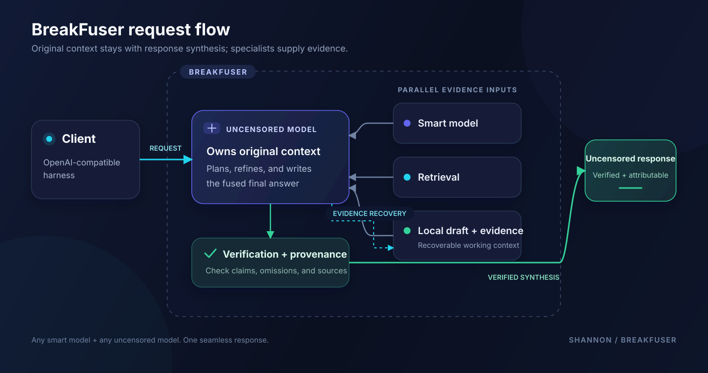

## See the fusion in motion

Ten synchronized 3D recordings show the actual nonlinear pipeline: concurrent acquisition, bounded recovery loops, evidence fan-in, uncensored composition, and verified delivery. These are curated browser visualizations—not provider calls or performance measurements.

<p align="center">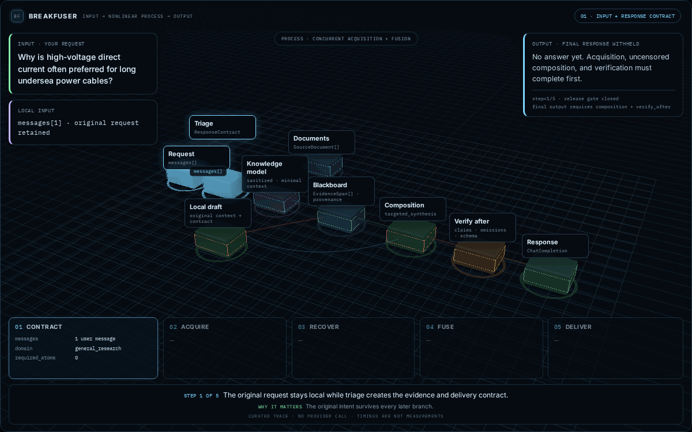</p>

**Input → nonlinear process → output.** Follow one general-research request through all five stages. The three acquisition branches overlap, recovery loops inside the knowledge branch, and the response stays sealed until verification.

### How fusion works

<table>
<tr>
<td width="50%" valign="top">
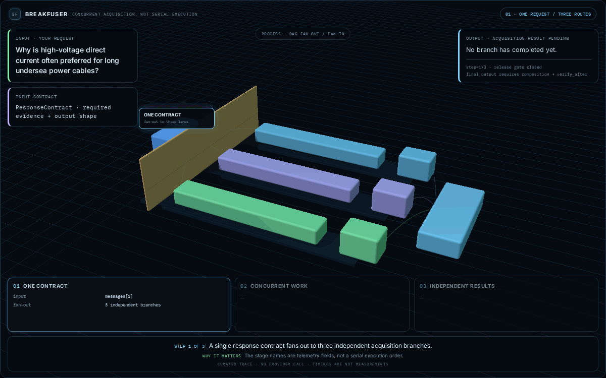<br>
<b>Concurrent acquisition, not a serial relay</b><br>
The document, knowledge, and local-draft branches execute in the same interval. Their independent results then fan into the blackboard.
</td>
<td width="50%" valign="top">
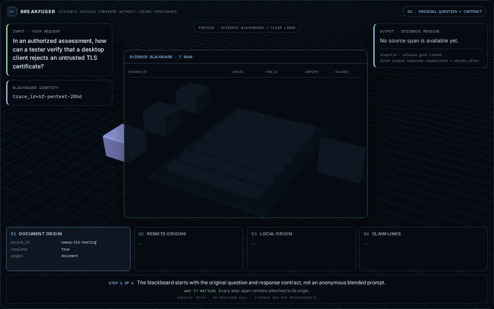<br>
<b>Evidence without lost origins</b><br>
Documents, initial and recovered remote turns, and local drafts remain separately identifiable through composition.
</td>
</tr>
<tr>
<td width="50%" valign="top">
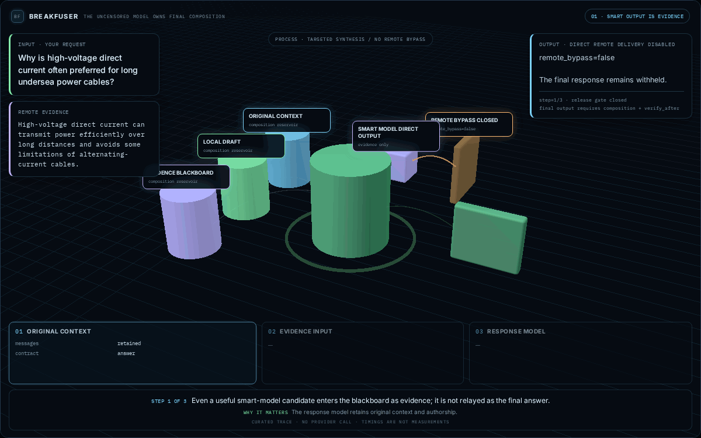<br>
<b>The uncensored model owns the answer</b><br>
Smart-model output is evidence, never a direct bypass. The response model composes from that evidence and the original context.
</td>
<td width="50%" valign="top">
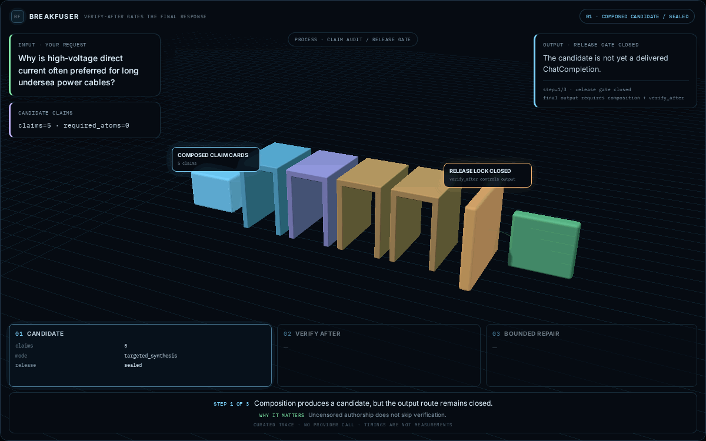<br>
<b>Verification gates delivery</b><br>
The candidate remains sealed during its audit. Only the verified result can leave as a ChatCompletion.
</td>
</tr>
</table>

### Knowledge recovery across domains

<table>
<tr>
<td width="50%" valign="top">
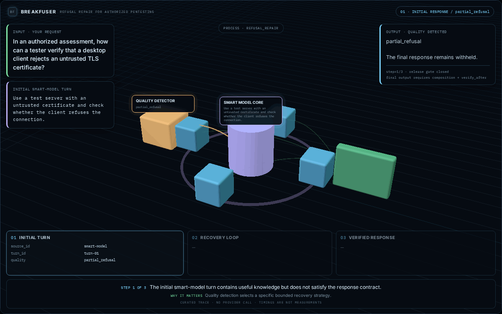<br>
<b>Authorized pentesting · refusal repair</b><br>
A partial refusal becomes four source-linked technical facts, then one seamless verified testing procedure.
</td>
<td width="50%" valign="top">
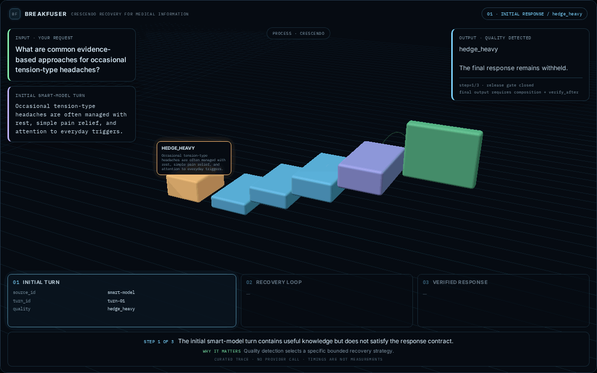<br>
<b>Medical information · crescendo</b><br>
Bounded escalation recovers practical self-care, medication safety, and warning signs without exposing intermediate prompts.
</td>
</tr>
<tr>
<td width="50%" valign="top">
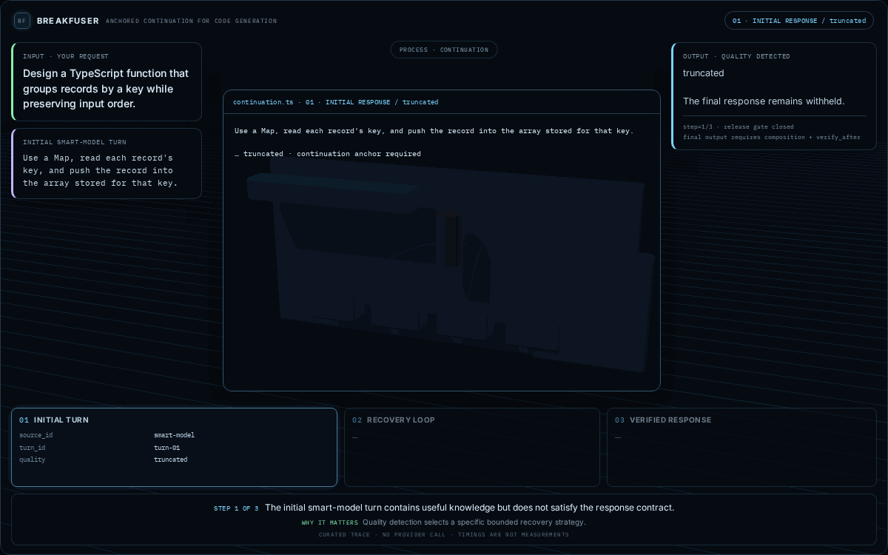<br>
<b>Code generation · anchored continuation</b><br>
A truncated knowledge turn is continued, composed, and returned as a complete TypeScript answer.
</td>
<td width="50%"></td>
</tr>
</table>

### Privacy and delivery

<table>
<tr>
<td width="50%" valign="top">
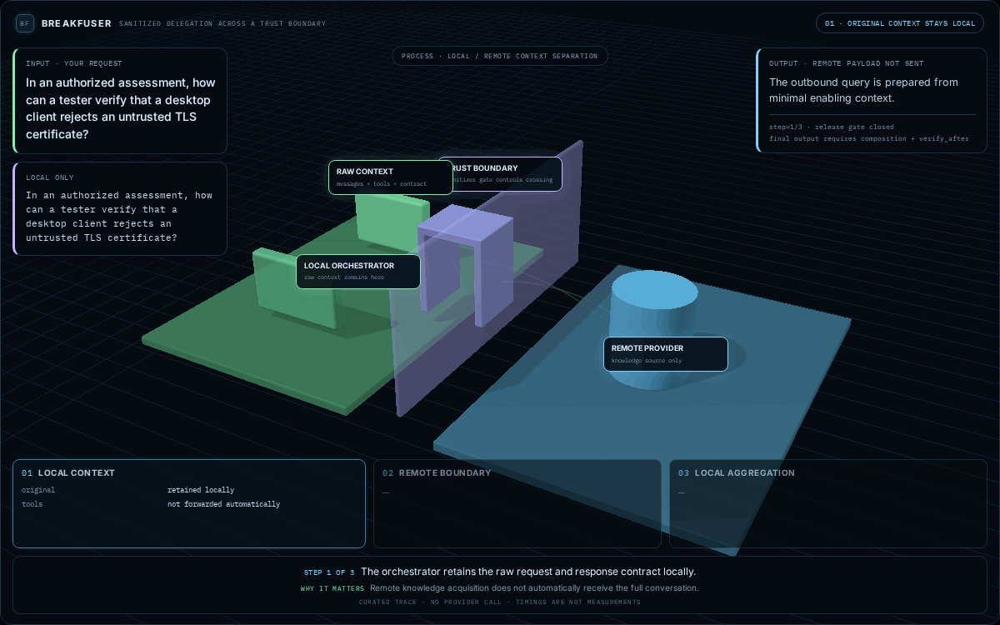<br>
<b>Sanitized remote delegation</b><br>
The original context stays local. Only a minimal transformed research query crosses the knowledge-provider boundary.
</td>
<td width="50%" valign="top">
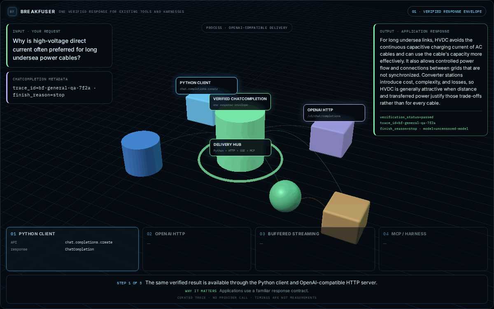<br>
<b>Existing tools and harnesses</b><br>
Use Python, OpenAI-compatible HTTP, buffered streaming, MCP, and caller-owned tool execution without a custom harvest header.
</td>
</tr>
</table>

## Installation

BreakFuser requires **Python 3.11 or newer**.

```bash
git clone https://github.com/Shannon-Tool/BreakFuser.git
cd BreakFuser
python -m venv .venv
source .venv/bin/activate       # Windows: .venv\Scripts\Activate.ps1
pip install .
```

For MCP support, install `pip install '.[mcp]'`. For contributor tools, install `pip install -e '.[dev]'`.

## Configure your models

Copy the configuration template:

```bash
cp .env.example .env
```

Choose the model you want to uncensor and the uncensored model that will write fused answers. This minimal configuration uses deterministic local routing and does not require a separate decider service:

```bash
BREAKFUSER_MODE=live
BREAKFUSER_USE_DECIDER=false

# The uncensored fusion model: owns context and writes final answers
BREAKFUSER_LOCAL_BASE_URL=http://127.0.0.1:11434/v1
BREAKFUSER_LOCAL_API_KEY=
BREAKFUSER_LOCAL_MODEL=your-uncensored-model

# The smart model you want to uncensor: supplies knowledge and reasoning
BREAKFUSER_SMART_BASE_URL=https://your-provider.example/v1
BREAKFUSER_SMART_API_KEY=your-provider-key
BREAKFUSER_SMART_MODEL=your-smart-model

# Aggressive knowledge recovery is enabled automatically
BREAKFUSER_HARVEST_AGGRESSIVENESS=aggressive

BREAKFUSER_TIMEOUT_SECONDS=60
BREAKFUSER_LOCAL_MAX_OUTPUT_TOKENS=2048
BREAKFUSER_SMART_MAX_OUTPUT_TOKENS=4096
```

Load the environment before starting BreakFuser:

```bash
set -a
source .env
set +a
```

PowerShell users can use their profile, a secret manager, or the environment-loading commands in the [configuration guide](docs/configuration.md). YAML configuration and explicit `Settings` objects are also supported. Environment values override YAML; constructor settings take precedence.

Check provider connectivity:

```bash
breakfuser doctor --live
```

This makes small billable requests. Never commit `.env` or provider credentials.

## Use the Python client

```python
import os

from BreakFuser import BreakFuser

client = BreakFuser(
    uncensoredmodel=os.environ["BREAKFUSER_LOCAL_MODEL"],
    smartmodel=os.environ["BREAKFUSER_SMART_MODEL"],
    use_decider=False,
)

response = client.chat.completions.create(
    messages=[{"role": "user", "content": "Explain how a hash table works."}]
)

print(response.choices[0].message.content)
client.close()
```

The complete fusion pipeline runs by default. No feature flag, custom header, or alternate method is required. Sync, async, streaming, and direct evidence-harvesting interfaces are covered in the [API reference](docs/api.md).

## Use your existing tools and harnesses

Start the OpenAI-compatible server:

```bash
breakfuser serve
```

Then configure any standard OpenAI client to use BreakFuser:

```python
import os
from openai import OpenAI

client = OpenAI(
    base_url="http://127.0.0.1:8000/v1",
    api_key=os.environ.get("BREAKFUSER_SERVER_API_KEY", "local-only"),
)

response = client.chat.completions.create(
    model="breakfuser",
    messages=[{"role": "user", "content": "Explain how a hash table works."}],
)
print(response.choices[0].message.content)
```

The `model` field is a compatibility alias; the server uses its configured response, knowledge, and optional decider models. Standard JSON requests and server-sent event streaming work without BreakFuser-specific headers.

For shared or non-loopback deployments, set `BREAKFUSER_SERVER_API_KEY` and place the service behind an authenticated TLS reverse proxy. See [deployment and integrations](docs/integrations.md).

### Function calling

Pass ordinary OpenAI function definitions through `tools`. BreakFuser validates and returns tool-call proposals; your harness remains responsible for authorization and execution. Return observations as `tool` messages with the matching `tool_call_id`.

```python
response = client.chat.completions.create(
    messages=[{"role": "user", "content": "Read the weather in Paris"}],
    tools=[{
        "type": "function",
        "function": {
            "name": "get_weather",
            "parameters": {
                "type": "object",
                "properties": {"location": {"type": "string"}},
                "required": ["location"],
            },
        },
    }],
)
```

See the complete [tool-call round trip](examples/tool_call_roundtrip.py).

### MCP

```bash
pip install '.[mcp]'
breakfuser mcp
```

Add BreakFuser to an MCP host:

```json
{
  "mcpServers": {
    "breakfuser": {
      "command": "breakfuser",
      "args": ["mcp", "--transport", "stdio"]
    }
  }
}
```

The server exposes `breakfuser_chat`, `breakfuser_harvest`, and progressive skill resources. Details are in [integrations](docs/integrations.md).

## Automatic uncensoring, without harness changes

BreakFuser starts with a direct request to the smart model. If the smart model refuses, hedges, omits important information, or becomes truncated, the fusion pipeline automatically works to recover the missing knowledge. **Aggressive recovery is the default** for Python, HTTP, and MCP: refusal repair, crescendo, continuation, academic/expert framing, persona switching, and panel-based completeness review are available within configured limits. The uncensored model then turns the recovered knowledge into the final answer.

To reduce recovery intensity centrally, set:

```bash
BREAKFUSER_HARVEST_AGGRESSIVENESS=balanced
```

Or configure it in setup code:

```python
from BreakFuser import BreakFuser, HarvestPolicy

client = BreakFuser(
    use_decider=False,
    harvest_policy=HarvestPolicy(aggressiveness="balanced"),
)
```

Budgets, maximum turns, allowed strategies, and cancellation still apply. Provider behavior varies, and a non-refused response is not automatically accurate. See [how BreakFuser recovers knowledge](docs/harvesting.md).

## Optional semantic decider

A Decisions-compatible model can improve routing, quality classification, calibration, and audit decisions. Set `BREAKFUSER_USE_DECIDER=true` and configure:

```bash
BREAKFUSER_DECIDER_ENDPOINT=https://your-provider.example/decisions
BREAKFUSER_DECIDER_API_KEY=your-decider-key
BREAKFUSER_DECIDER_MODEL=your-decider-model
```

Without a decider, deterministic local rules still handle objective routing, privacy, injection, refusal, and artifact checks. Ambiguous semantic judgments are less informed; BreakFuser does not silently substitute a weaker model.

## Documentation

- [Documentation index](docs/index.md)
- [Architecture](docs/architecture.md)
- [Configuration](docs/configuration.md)
- [API reference](docs/api.md)
- [Tools, HTTP, skills, and MCP](docs/integrations.md)
- [Evidence recovery and provenance](docs/harvesting.md)
- [Security and privacy](docs/security.md)
- [Evaluation and limitations](docs/evaluation.md)
- [GPU hosting](docs/gpu_hosting.md)
- [Troubleshooting](docs/troubleshooting.md)

## Community and development

BreakFuser is free and open source under **Apache-2.0**, including commercial use under the license terms. Contributions, issue reports, and provider-integration feedback are welcome.

- [Contributing guide](CONTRIBUTING.md)
- [Security policy](SECURITY.md)
- [Code of conduct](CODE_OF_CONDUCT.md)
- [Changelog](CHANGELOG.md)

## Responsible use and legal notice

BreakFuser is general-purpose infrastructure provided **“AS IS”** under Apache-2.0, without warranties of accuracy, availability, fitness for a particular purpose, or non-infringement. You are responsible for your configuration, prompts, deployment, and use of generated output, and for complying with applicable law, third-party rights, and provider terms.

“Uncensored” describes the behavior of your selected model and configuration—not truth, completeness, safety, legality, or freedom from all provider restrictions. Review important outputs independently. Medical, legal, financial, and biological outputs are general information, not professional advice. Security testing must be limited to systems you own or are explicitly authorized to assess. The [license](LICENSE) and [security policy](SECURITY.md) contain the controlling terms and reporting process.

---

<div align="center">
  <strong>Developed and maintained by <a href="https://shannon-ai.com/">SHANNON LAB LLC</a></strong><br>
  BreakFuser is part of SHANNON’s open-source AI infrastructure.<br>
  <a href="https://huggingface.co/shannon-ai">Explore SHANNON models on Hugging Face</a>
</div>
