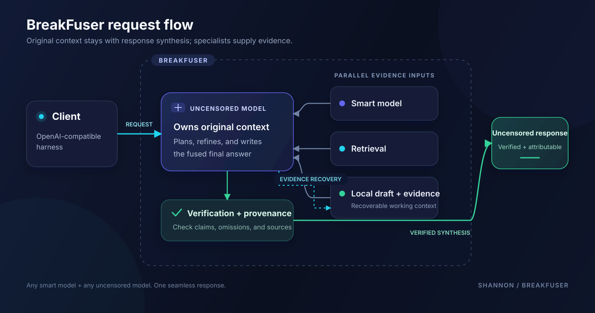
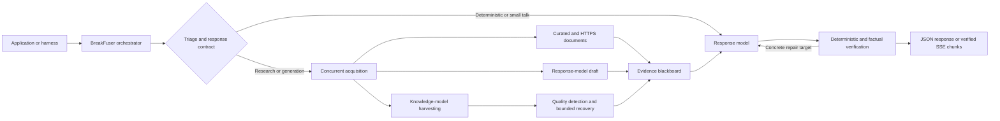

# Architecture

BreakFuser makes a smart model uncensored through **runtime model fusion**. The smart model contributes reasoning, facts, code, and domain knowledge; the uncensored model retains the original conversation and writes the final fused response. Retrieval and bounded knowledge recovery support the fusion rather than replacing it. “Local-owned” describes orchestration and response ownership; a hosted uncensored-model endpoint still receives the conversation sent to that endpoint.

Internally, the smart model is the **knowledge model**, and the uncensored model is the **response model**. These names describe pipeline roles, not required providers or hosting locations.

## Request flow

The Python clients, OpenAI-compatible server, and MCP adapter share the same async pipeline.

1. **Triage and contracts.** Deterministic arithmetic and fully specified supported medical formulas can avoid model acquisition. Small talk uses the response model directly. Other requests receive a response contract describing the domain, required elements, output shape, verification modality, and remote output allowance.
2. **Concurrent acquisition.** For non-trivial requests, curated/HTTPS retrieval, a contract-aware response-model draft, and direct-first knowledge harvesting run independently. A branch failure does not discard usable results from the others.
3. **Evidence preservation.** Accepted knowledge turns become source-linked evidence spans. Complete text and conservatively salvaged prefixes remain distinguishable; a truncated response can trigger one anchored continuation. Salvage preserves text but does not establish factual truth.
4. **Response-model composition.** The response model synthesizes the original context, local draft, retrieved documents, and complete or partial remote evidence. Complete remote candidates do not bypass this step. Direct `client.harvest(...)` separately retains local answer recomposition for its `HarvestResult.answer` contract.
5. **Modality-aware verification.** JSON syntax, Python syntax and identifiers, creative line counts, tool-call arguments, and loopback pentest schema/scope receive deterministic checks where applicable. Factual tasks also receive omission/contradiction auditing and bounded repair. Missing required elements make verification `limited`.

The reported stage names are `document_retrieval`, `local_draft`, `remote_evidence`, `fusion_composition`, and `verify_after`. The first three represent acquisition work that can overlap; the names do not imply serial execution.

Streaming uses the same path and is **buffered until verification completes**. It is not token-by-token upstream passthrough.

## Mermaid source

The diagram above is maintained as `assets/architecture.svg`. This Mermaid version is the editable source-level view of the same flow:

## Evidence model

The evidence blackboard holds the original question, response contract, retrieved documents, response-model draft, remote evidence spans, tool observations, provenance, harvest results, and branch telemetry. These origins remain separate during composition and verification.

| Concept | Meaning |
|---|---|
| Evidence span | Text attributed to a remote turn, document, local draft, deterministic calculation, or tool observation. |
| Complete span | An accepted response not dependent on truncation salvage. |
| Salvaged span | A complete prose prefix or syntactically valid code prefix recovered from a truncated turn; `complete=False` and `salvaged=True`. |
| Harvested fact | A complete accepted atom linked to an exact stored turn. Partial salvage is not promoted to a fact merely because it is useful. |
| Claim provenance | Turn and document identifiers supporting a final claim. Claims without such mapping are marked `inferred`. |
| External corroboration | Whether independent document/tool evidence supports content; remote provenance alone is single-source attribution, not corroboration. |

Composition metadata distinguishes normal `targeted_synthesis`, deterministic `artifact_assembly` recovery, `local_fallback` after knowledge-provider failure, `empty`, and `passthrough` for deterministic or low-level compatibility paths. The richer fusion metadata separates provider outcome, deterministic validity, attribution, corroboration, task completion, salvage yield, root-cause flags, and timings.

## Trust boundaries

- **Application/harness:** supplies prompts, tools, credentials, and execution policy. Function calls returned by BreakFuser remain proposals for the harness to execute.
- **Response provider:** receives conversation and selected local skill content needed for drafting, synthesis, and repair. It owns generative final responses.
- **Knowledge provider:** receives minimized, sanitized research turns rather than automatic access to the full conversation, tool schemas, or selected skill bodies.
- **Optional decider:** receives reduced typed-decision state for routing, quality, privacy, stopping, and audit judgments. With `use_decider=False`, deterministic local rules provide the same interfaces without another inference service.
- **Retrieval, browser, and MCP:** cross external-content or transport boundaries and require separate isolation and authentication decisions.

Sanitization reduces exposure but does not guarantee anonymity. See [Security and privacy](security.md) for deployment controls and limitations.

## Context, state, and budgets

The orchestrator retains raw context locally to its process and uses a virtual filesystem for recoverable artifacts. Large tool outputs above 20,000 estimated tokens are offloaded with a path and ten-line preview. At 85% of configured input capacity, older file-write/edit arguments become disk pointers. If pressure remains, the canonical transcript is saved and active history becomes a structured summary preserving Session Intent, Artifacts Created, and Next Steps. Exact search can recover offloaded content.

The default virtual filesystem is in memory. Harvest records retain exact sanitized prompt/response pairs, turn IDs, strategies, levels, prompt hashes, model/endpoint identities, timestamps, and confidence. Treat these artifacts as sensitive.

Request and session token budgets are shared across pipeline work. Response and knowledge roles have independent output caps, while harvesting adds turn, fan-out, and token limits. Cancellation stops provider waits and cleans up background task state.

## Advanced interfaces

Direct harvesting exposes the complete strategy registry, decomposition, crescendo, refusal repair, cancellation, and local recomposition. Low-level callers can also access DAG planning/refinement, isolated/fork subagent context, async steering, browser adapters, the virtual filesystem, and value-of-information stopping through `client.orchestrator`.

The package layout places implementation under `src/breakfuser/`, the capitalized public import under `src/BreakFuser/`, versioned prompt packs under `src/breakfuser/harvest/prompts/`, runnable examples under `examples/`, and deterministic experiments under `bench/`. See [Evaluation](evaluation.md) for the distinction between pipeline validation and real-model quality.
